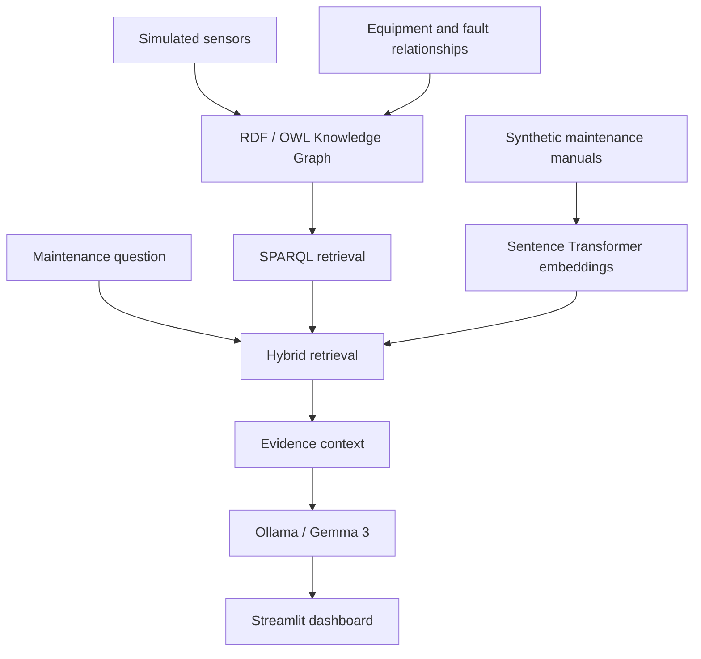

# Industrial GraphRAG Copilot 🏭

**Explainable industrial maintenance assistance using RDF Knowledge Graphs, SPARQL, semantic document retrieval, and local LLMs.**

This portfolio prototype combines simulated industrial sensor measurements, RDF/OWL equipment relationships, synthetic maintenance manuals, and a locally hosted Gemma 3 model through Ollama.

## Features
- Fleet monitoring and illustrative sensor-threshold alerts
- RDF knowledge graph with `owl:sameAs` identity alignment
- SPARQL retrieval of sensor readings, components, possible faults, and maintenance actions
- Embedding-based retrieval over synthetic maintenance manuals
- Evidence-grounded local LLM explanations with source references
- Streamlit dashboard and interactive PyVis graph

## Architecture



## Run locally

Requires Python 3.10+ and [Ollama](https://ollama.com/).

```bash
python -m venv .venv
source .venv/bin/activate
pip install -r requirements.txt
ollama pull gemma3:4b
streamlit run app.py
```

The embedding model may download on first use. Start Ollama before asking the AI assistant a question.

## Example

**Why might M102 be malfunctioning?** In the synthetic scenario, M102 has a temperature of 89°C and vibration of 6.2 mm/s, above illustrative thresholds of 80°C and 5 mm/s. The graph suggests possible bearing wear, while the manual describes inspection of lubrication and alignment. This is **not a confirmed diagnosis**.

## Technology

Python · RDFLib · RDF/OWL · SPARQL · Sentence Transformers · Ollama · Gemma 3 · Streamlit · PyVis

## Disclaimer

All machine readings, manuals, faults, and thresholds are **synthetic or illustrative**. This prototype is not a certified diagnostic system or replacement for qualified maintenance personnel.
