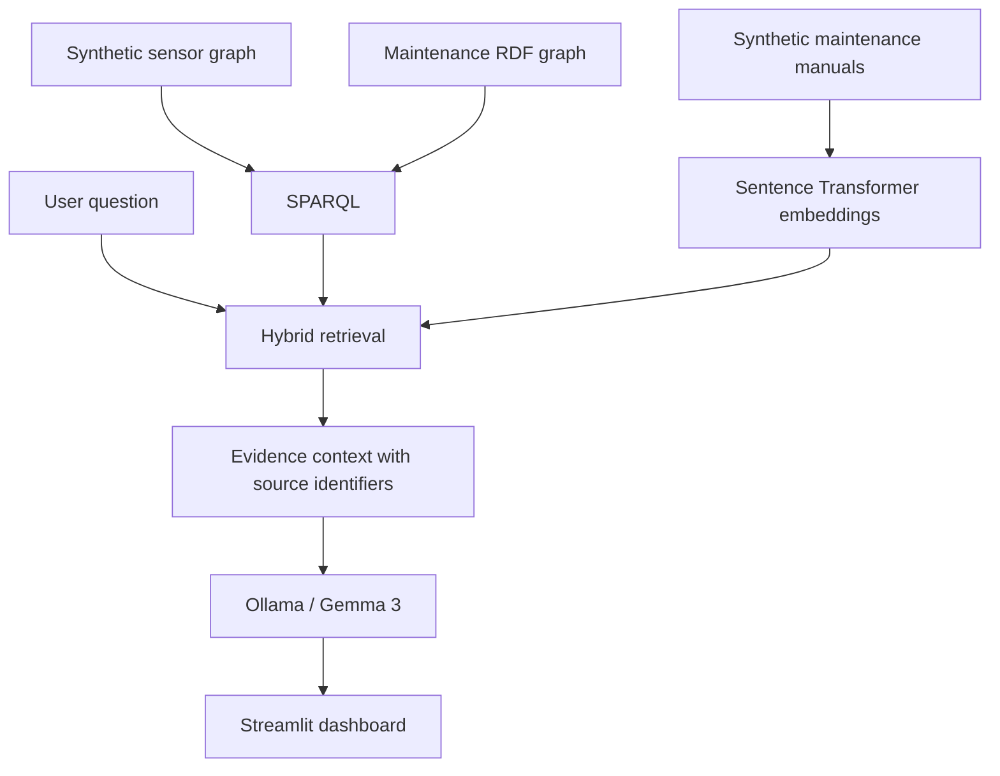

# Industrial GraphRAG Copilot 🏭

**Explainable industrial maintenance assistance with RDF knowledge graphs, SPARQL, semantic search, and a local LLM.**

A hands-on portfolio prototype that brings together synthetic machine sensor readings, maintenance knowledge, document retrieval, and evidence-grounded natural-language answers.

> **Demo only:** All equipment data, faults, and maintenance documents are synthetic. This application is not an industrial safety or diagnostic system.

## What it does

- **Fleet overview:** explore five simulated machines and their sensor readings.
- **Machine details:** inspect temperature, vibration, and linked maintenance knowledge.
- **Knowledge graph:** visualize RDF relationships between machines, components, faults, and maintenance actions.
- **AI assistant:** ask questions about machine behavior and receive locally generated answers with evidence references.
- **Evidence explorer:** inspect the retrieved graph and document context supporting answers.

## Architecture



### Knowledge graph

The RDF graph models machine readings, maintenance observations, components, possible faults, and actions. It uses **OWL `owl:sameAs`** to connect machine identifiers from different synthetic data sources.

### Hybrid retrieval

The copilot combines:
1. **Structured evidence:** RDFLib SPARQL queries over sensor and maintenance graphs.
2. **Unstructured evidence:** semantic similarity retrieval from local maintenance text files using `all-MiniLM-L6-v2`.
3. **Answer generation:** a local `gemma3:4b` model through Ollama, prompted with retrieved evidence and source labels such as `[SENSOR-1]`, `[KG-1]`, and `[DOC-1]`.

## Technology stack

| Layer | Technology |
| --- | --- |
| Knowledge representation | RDF, OWL, Turtle, RDFLib |
| Structured retrieval | SPARQL |
| Document retrieval | Sentence Transformers |
| Local language model | Ollama, Gemma 3 4B |
| Dashboard | Streamlit, Pandas |
| Graph visualization | PyVis |
| Language | Python |

## Getting started

### Requirements

- Python 3.10+ recommended
- [Ollama](https://ollama.com/) installed and running
- Internet access on first run to download the embedding model, if not cached

### Install

```bash
git clone https://github.com/GhinwaFAKIH/industrial-graphrag-copilot.git
cd industrial-graphrag-copilot

python3 -m venv .venv
source .venv/bin/activate
pip install -r requirements.txt

ollama pull gemma3:4b
```

Start Ollama if it is not already running, then launch the dashboard:

```bash
streamlit run app.py
```

### Example question

**“Why might M102 be malfunctioning?”**

In the synthetic dataset, M102 has a temperature reading of **89°C** and vibration of **6.2 mm/s**. The knowledge graph links the equipment to a possible bearing-related maintenance issue, while retrieved manual text offers relevant inspection guidance. The copilot combines these sources into a cited explanation rather than presenting a confirmed diagnosis.

## Project structure

```text
industrial-graphrag-copilot/
├── app.py                     # Streamlit dashboard
├── graphrag_ollama.py         # GraphRAG orchestration and local LLM
├── document_retrieval.py      # Semantic manual retrieval
├── main.py                    # Synthetic sensor graph generation
├── add_maintenance.py         # Maintenance graph enrichment
├── align_graph.py             # OWL identity alignment
├── visualize_graph.py         # Knowledge graph visualization
├── industrial_kg.ttl
├── industrial_kg_enriched.ttl
├── industrial_kg_aligned.ttl
├── maintenance_docs/          # Synthetic reference documents
├── tests/                     # Offline graph tests
└── requirements.txt
```

## Tests

```bash
python -m pytest tests/
```

If `pytest` is not installed, install it with `python -m pip install pytest`.

## Scope and limitations

This is an **explainability-focused research and portfolio demonstration**, not a validated predictive-maintenance model. Sensor thresholds are illustrative, the data is synthetic, and an LLM-generated explanation must not be used to make real equipment safety decisions.

Potential future extensions include live industrial data ingestion, SHACL validation, graph-enhanced ranking, temporal reasoning, and systematic evaluation of evidence attribution.
